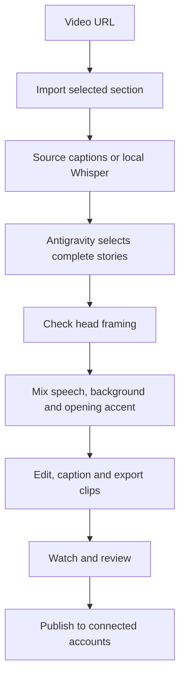

<div align="center">


**Turn a long video into short clips with a story worth finishing.**

[](https://github.com/xASHx26/clipmax---Cliping-with-antigravity-cli/actions/workflows/ci.yml)


[Partner setup · Windows](#partner-setup-windows) · [Connect YouTube](#connect-your-youtube-channel) · [Build an EXE](#build-a-windows-app) · [Run with Docker](#run-with-docker) · [Plugins](#plugins-live-inside-clipmax) · [Publishing](#preview-then-publish)

</div>

## Your content, reimagined

Paste a video link. Find the weird reaction, unexpected reveal, emotional story, or standout exchange. Clipmax imports the selected section, creates timed captions, asks Antigravity to select complete moments, and exports clips you can watch before sharing.

| In the studio | What it does |
| :--- | :--- |
| **Link → clips** | Import recorded YouTube, Twitch, Vimeo, TikTok, Facebook, and Instagram videos. Scan up to two hours of a longer recording. |
| **Story-aware selection** | Look for setup, context, and payoff. Uncertain endings are flagged for review. |
| **Local AI captions** | Use source subtitles or transcribe audio with the bundled multilingual Whisper model. Export animated phrase captions with word highlights, or choose steady/clean styles; SRT downloads remain available. |
| **Head-safe layouts** | Sample faces and camera panels, add headroom, or preserve the full source over a blurred background when uncertain. |
| **Mood-aware audio** | Keep speech clear, duck background beds, and choose varied opening accents to suit the edit. Choose 17 opening accents and 13 background styles with per-clip arrangements, or upload your own audio. |
| **AI publishing details** | Gemini CLI via Antigravity writes clip-specific titles, descriptions and search tags from the actual clip transcript. Uses the source creator name in both title and description, with an editable override, specific curiosity hooks and relevant creator/topic tags. Review or regenerate them in Edit clip; YouTube receives the description and tags automatically. |
| **Live project tree** | Follow the vertical workflow with animated connections and progress from actual media-tool telemetry. Project cards show live work indicators and measured upload progress without interrupting previews. |
| **AI profile & quota** | Open the profile dashboard for provider-reported quota, reset times and account-report history. Manage sign-in through Antigravity’s official CLI. Low Gemini quota pauses AI work at 15% remaining; resume from saved source captions after a quota reset or official account switch. Unknown or stale balances are labeled. |
| **Cancel and retry** | Stop active importing, transcription, AI selection or encoding, or remove a queued task. Keep downloaded source and completed exports; retry or delete after cancellation finishes. |
| **Review and refine** | Play previews, trim, edit captions and titles, adjust mood, and recheck framing. Delete a project and all of its local media after two confirmations. |
| **App-side MCP** | Connect optional editing and research services in the Plugins tab and run tools with reviewed inputs. |
| **Multi-platform publishing** | Assisted browser posting in the desktop app, or direct API uploads with supported account permissions. |



Editorial scores and mood labels are suggestions. Framing checks sample six frames per clip; they are not continuous tracking. Review captions, composition, and story endings before posting. No tool can guarantee views.

## Partner setup: Windows

Start here on a new computer. **Use your own Antigravity sign-in and your own YouTube channel.** Your partner does not need your private configuration or credentials.

### 1. Install the prerequisites

- Windows 10/11, 64-bit, with several GB of free space for dependencies, media tools and build output.
- [Node.js 22 or newer](https://nodejs.org/en/download) and [Git for Windows](https://git-scm.com/downloads/win).
- The official [Antigravity CLI for Windows](https://antigravity.google/docs/getting-started?tab=cli). Follow Google's Windows installation instructions. The official PowerShell installer is shown below; open a **new PowerShell window** afterward so the updated PATH is loaded.

```powershell
irm https://antigravity.google/cli/install.ps1 | iex
```

Check the tools:

```powershell
node --version
git --version
agy --help
```

### 2. Connect Antigravity CLI

```powershell
agy
```

Complete Antigravity's one-time setup and its official browser sign-in. Choose the Google account with your Antigravity access. Sign-in happens with Google; Clipmax does not ask for your Google password. After the CLI opens normally, exit it and confirm that model discovery works:

```powershell
agy models
```

There is no `agy login` or `agy auth` subcommand in the CLI version used here. Launch `agy` to use its own sign-in controls. If you switch accounts, do it through Antigravity, then refresh usage before resuming Clipmax.

In Clipmax choose **AI engine → Antigravity CLI**. Use a model ID shown by `agy models`, or clear the Model field to use the CLI default. Available models depend on your account. **No Gemini API key or .env file is required for the Windows desktop app's CLI route.** The optional Gemini API engine has separate API quota and billing.

### 3. Download and run Clipmax

```powershell
git clone https://github.com/xASHx26/clipmax---Cliping-with-antigravity-cli.git
cd clipmax---Cliping-with-antigravity-cli
npm.cmd ci
npm.cmd run setup
npm.cmd run desktop
```

Run the commands from the repository folder. `npm.cmd` avoids PowerShell's npm.ps1 launcher-policy issue. Setup downloads yt-dlp, Whisper and its speech model, and the face model; FFmpeg is installed with the dependencies. The desktop app starts its own local server and stores settings automatically. Keep an internet connection available for the first setup and for AI requests.

If you receive a prebuilt portable EXE instead, install/sign into Antigravity first and open that EXE. Node.js, Git and npm are needed for building or running from source, not for running the bundled EXE. The repository's `Launch Clipmax.cmd` is a shortcut for an already installed app, not a fresh installer.

### Build a Windows app

From the repository folder, after completing setup:

```powershell
npm.cmd test
npm.cmd run build:app
```

The output is **`release/Clipmax-Studio-0.12.3-Windows.exe`**. Future versions use the version number in package.json. This is an unsigned portable Windows x64 app. Share that EXE with your partner; the `release/` directory is intentionally excluded from Git. Antigravity must still be installed and signed in separately on their PC. Media tools and local models are bundled.

To update a source checkout later, finish or cancel running projects, close Clipmax, run `git pull`, then repeat `npm.cmd ci`, `npm.cmd run setup`, tests and build. Keep the app's existing application-data folder to retain projects and connections.

### Connect your YouTube channel

A Google login in your browser alone does not grant Clipmax upload access. Set up a Google Desktop OAuth client once, then connect the channel inside Clipmax. These are your own Google developer credentials; there is no Clipmax publishing-service subscription for this route.

**Partner using your existing Google project:** you do not need to create another project. Add their Google email under **Google Auth Platform → Audience → Test users** while the app is in Testing. Download the JSON from your existing **Desktop app** client under **Clients**, give that desktop client file to your partner, and have them import it in Clipmax. The **Client ID** and **Client secret** fields identify the app; they are not the partner's email or password. Your partner then clicks **Continue to sign in** and grants access with their own channel account. Each computer saves its own channel authorization; do not copy your `connections.enc`, `credentials.key`, or user-data folder.

1. Open [Google Cloud Console](https://console.cloud.google.com/) using an account that can manage the setup. Create a project, for example **Clipmax**. A paid trial is not required just to configure OAuth and enable the YouTube Data API.
2. Open **APIs & Services → Library**, search **YouTube Data API v3**, and enable it.
3. Open **Google Auth Platform → Branding** (older consoles may call this **OAuth consent screen**). Set the app name, your support email and developer contact details. Complete Google's required policy acknowledgments yourself.
4. Under **Audience**, choose **External** for a personal account. While the app is in **Testing**, add the Google email that owns/manages the YouTube channel as a **test user**. Add your partner's channel account too if they use this developer project.
5. Under **Data Access**, add the requested scopes: `https://www.googleapis.com/auth/youtube.upload` and `https://www.googleapis.com/auth/youtube.readonly`.
6. Open **Clients → Create client**. Choose **Desktop app** and name it **Clipmax Desktop**. Download the OAuth client JSON and keep it private. If Google only offers the secret once, download it before closing the creation dialog. Do not create a Web application client; Desktop clients handle the local loopback callback automatically.
7. In Clipmax click **+ Add connection → YouTube → Direct API sign-in**. Expand **One-time platform app setup** and choose **Import Google Desktop OAuth JSON**. Select the file from step 6, then click **Continue to sign in**.
8. In Google's browser flow, select the account/channel you actually want to publish to and review the requested YouTube permissions. A self-created app in Testing can show an unverified-test-app notice; verify it is the developer app you just created before continuing.
9. Return to Clipmax. Under **Connections**, confirm the correct channel name appears as **YouTube · Direct API · Active account**. If the name is wrong, reconnect the intended channel before posting.
10. Use **Watch clip** and **Edit clip** to check the video, streamer name, title, description and tags. Choose **Publish selected** and start with **Private** visibility for a real upload check. Review the actual visibility and upload result in YouTube Studio before choosing Public for subsequent uploads.

For future projects you may enable **Auto-upload after export**, select the verified channel, choose visibility and give publishing consent. Leave it off to review each clip first. Connecting an account does not post existing clips by itself.

Google references: [Desktop OAuth clients and loopback callbacks](https://developers.google.com/identity/protocols/oauth2/native-app), [YouTube authorization](https://developers.google.com/youtube/v3/guides/authentication), [upload restrictions](https://developers.google.com/youtube/v3/docs/videos/insert).

### Check AI quota and resume work

Click **Your workspace → AI accounts & quota** at the bottom of the sidebar. Choose **Manage account & quota** to open the official Antigravity CLI with Clipmax's session-only usage reporter. Complete CLI setup/sign-in if prompted and open **`/usage`**. Return to Clipmax and press **Refresh**.

The dashboard records Antigravity-reported account email, model, quota percentage, reset times and conversation token counts. Older reports are marked stale. Unknown balances remain unknown; conversation tokens are not a remaining account-token balance. Some headless CLI runs do not emit status-line telemetry, so use the interactive quota panel when no report is available.

Fresh Gemini quota reports at or below **15%** pause new CLI AI work. An explicit provider quota error also creates an **AI paused** state instead of failing the whole import. After a reset, or after switching accounts through Antigravity's own controls, refresh `/usage` and choose **Resume AI from saved captions**. The downloaded video and transcript are reused. This retries the interrupted AI step; it cannot transfer a partially generated answer between accounts. **Automatic rotation of Google sign-in credentials is not implemented.** [Official quota telemetry](https://antigravity.google/docs/cli/statusline/) · [Quota panel](https://antigravity.google/docs/cli/commands/usage/).

### What to send your partner

Send the repository link or the portable EXE and this guide. They should authorize their own accounts. Never share `.env`, `connections.enc`, `credentials.key`, downloaded OAuth client JSON, API keys, or an entire copy of your application-data folder. Windows encryption ties saved desktop connections to the Windows profile that created them.

### Common setup problems

| Problem | What to check |
| :--- | :--- |
| `agy` is not recognized | Reopen PowerShell and Clipmax after installing the CLI. Check `Get-Command agy`. A custom installation can use AGY_PATH before starting the app. |
| Model not found / no model access | Run `agy models`; use an accessible ID, or clear Clipmax's Model field. |
| No quota report in the dashboard | Open **Manage account & quota**, complete CLI onboarding, run `/usage`, return and Refresh. Missing data is not treated as zero quota. |
| Google says access is blocked / app is being tested | Add the exact channel owner's Google email as a test user in the correct Cloud project. |
| Invalid OAuth client or redirect | Import a **Desktop app** JSON containing an installed client, not a Web client or service-account key. |
| Channel connection expired | Reconnect using **+ Add connection** and grant access again. Testing-mode OAuth grants can expire. |
| Video processing is taking too long | Open Project tree for the measured stage. **Cancel** stops processing and keeps saved media; after it finishes cancelling you can retry or delete the project. |

## Run with Docker

Requires **Docker Engine or Docker Desktop with Linux containers**, and **Docker Compose v2**. The container serves the studio in your browser; it does not run the Windows Electron shell.

```bash
git clone https://github.com/xASHx26/clipmax---Cliping-with-antigravity-cli.git
cd clipmax---Cliping-with-antigravity-cli
docker compose up -d --build
```

Open **[localhost:4310](http://localhost:4310)**. No `.env` file is needed to start the studio. The first build downloads dependencies, the speech model, the face model, and the official Antigravity CLI. Allow several minutes and enough disk space for video imports.

### Connect your AI

The image includes `agy`. A container is a separate Linux environment: your Windows Antigravity sign-in is **not** automatically shared with it.

```bash
docker compose exec -e SSH_CONNECTION="container" clipmax agy
```

Complete the CLI setup. The SSH environment requests Antigravity's documented remote sign-in flow: open the printed URL in your browser and return its authorization code to the terminal. Exit the CLI when finished. The home volume retains CLI settings and any credential files the CLI saves. Google's native keyring integration can require a Linux Secret Service; a personal-account login inside a headless container has not been verified. See [Google's authentication guide](https://antigravity.google/docs/install/) for supported headless and enterprise authentication.

For a browser-based alternative, open **AI settings** and supply your own Gemini API key, then choose Gemini as the project engine. Gemini API usage has its own quota and billing. Nothing is embedded in the image. Keep **Model** empty for the CLI default, or use an actual model ID listed by your installed CLI.

### Daily commands

```bash
docker compose logs -f --tail 100       # Follow app logs
docker compose stop                    # Stop the studio
docker compose start                   # Start it again
docker compose up -d --build            # Rebuild after pulling updates
docker compose run --rm -T clipmax npm test
docker compose run --rm -T clipmax node scripts/verify-container.mjs
```

The container includes Node.js 22, FFmpeg with subtitle support, yt-dlp, CPU Whisper, the face model, and Antigravity. whisper.cpp and yt-dlp versions are selected in the Dockerfile; the official Antigravity installer follows Google's rolling channel and verifies its downloaded payload with SHA-512.

### Storage and connections

| Docker volume | Contents |
| :--- | :--- |
| `clipmax_projects` | Downloaded sections, transcripts, exports, project progress, trash, encrypted app connections, and the app vault key. |
| `clipmax_antigravity-home` | The container user's Antigravity settings, caches, and CLI-managed authentication files. |

The app generates its vault key on first start with restricted file permissions. Restarting preserves it. Back up the **entire projects volume**, including settings and `vault.key`; encrypted connections need the same key to reopen. The key and encrypted data share a local volume, so disk and backup access controls still matter. Advanced deployments can supply `CLIPMAX_VAULT_KEY_FILE` as a read-only Docker secret containing a 32-byte base64 key.

`docker compose down` keeps named volumes. **Adding `--volumes` removes their data.** Interrupted processing is marked stopped on restart and can be retried; uncertain uploads require checking the platform before retrying.

The published port is bound to `127.0.0.1`, and Host/Origin checks remain enabled. This is a local, single-user application. Public hosting needs authentication and additional deployment work; do not expose port 4310 directly to the internet.

## Animated captions and fresh audio

Choose **Pop & highlight**, **Word highlight**, or **Clean phrases** under editing settings. Captions use short phrases, bold outlines, safe positioning, and font fitting. Whisper full JSON preserves word/subword timestamps when valid; source-caption tracks and older projects use estimated word timing. SRT downloads stay plain and portable. To update an existing unposted clip, open Edit clip and choose **Re-render captions & sound**.

Automatic batches vary suitable music families and save an arrangement seed for each clip, so exporting again preserves the chosen mix. **New background variation** chooses another arrangement without changing the original voice. New original sounds include tight bass drops, rimshots, rewinds, camera snaps, sparkle reveals, error bloops, cartoon slides, energy hits, and bright glass accents. Backgrounds add lo-fi keys/drums, bouncy bass, comedy pizzicato, cinematic piano/pads, and suspense pulses alongside fingerpicked acoustic, playful fiddle/plucks, epic orchestral builds, and the existing options. These are original synthesized arrangements, not extracted meme soundtracks.

Reference videos supplied for this update: [Jack reaction edit](https://www.youtube.com/shorts/8PwGWe7cZbU), [golf commentary](https://www.youtube.com/shorts/C3rTyacPgM8), [alarm demonstration](https://www.youtube.com/shorts/nCjoqIu_N1U), and [Gatorade edit](https://www.youtube.com/shorts/u4kTT35aoIY). Frame inspection shows short commentary captions versus persistent meme headlines. Antigravity also analyzed the audio through its native media reader: reaction vocals/pitch drops, acoustic/folk backing, fiddle/chime cues, and an orchestral swell with bass/energy accents were reported. Exact soundtrack identities are unconfirmed; reference audio is not shipped with Clipmax. See the [reference study](docs/reference-study.md).

## Preview, then publish

Use **Watch clip** in Clip studio or Project tree to see the final video with its audio and captions. Manual review is the default.

**Delete a project:** Delete opens a warning, then a final confirmation where you type **DELETE**. Confirming permanently erases that project's imported video, exported clips, captions, audio mixes and working files. It frees local disk space and has no Undo. Published posts and copies saved outside the project are unaffected. Active processing, editing and uploading must finish or be cancelled first.

After **Publish selected**, a live panel shows preparation, measured progress for each clip/platform, accepted uploads, and persistent failure reasons. Reopen it with **Upload progress** on the project. Accepted uploads can still be processing on the platform. YouTube's `uploadLimitExceeded` is a channel upload limit; [YouTube recommends trying again in 24 hours](https://support.google.com/youtube/answer/10383400). A new manual publish request can retry confirmed rejections, while successful or ambiguous uploads stay protected from duplicate posting.

**Auto-upload after export** is optional for new projects. It requires consent and verified API accounts for every selected destination. A changed account, unconfirmed story ending, or uncertain interrupted upload blocks automatic posting.

| Connection | Desktop app | Docker / browser studio |
| :--- | :--- | :--- |
| **Continue in your browser** | Opens the platform upload page, copies the caption, and reveals the export. You select the account, attach the video, and finish posting. | The desktop handoff is unavailable. Download the clip and post in your own browser. |
| **Direct API** | Supported with valid permissions and tokens. | Uses the same backend upload integrations and account settings. |
| **Account verification** | API tokens are verified; browser connection labels are not verified identities. | Same API verification rules. |

Official publishing APIs still impose platform requirements: YouTube/TikTok OAuth need registered applications; TikTok can require posting approval; Facebook publishes to Pages; Instagram needs a professional account. Facebook Login for Business connections upload the local video directly; Instagram Login connections need publicly accessible HTTPS media. Browser sign-in does not grant API publishing permissions. Real-account uploads have not been verified across every platform.

Automatic credential rotation is **not implemented**. The profile dashboard reports official CLI quota when available; low quota pauses AI so you can refresh or switch through Antigravity and resume from saved captions.

## Connect accounts for automatic uploads

Open **+ Add connection**. Direct platform connections are the default and have no extra publishing-service subscription. Platform registration, grants, quotas and review still apply. Sign in and grant publishing access using your own developer application.

- **YouTube:** enable YouTube Data API, create a Desktop OAuth client, and import its downloaded JSON in Clipmax or enter the client ID once. Continue to Google sign-in and select the channel. Refresh tokens are saved in the local encrypted vault.
- **TikTok:** use a registered Desktop app with Login Kit and approved video.publish access. Continue to TikTok sign-in. Unaudited clients can be restricted to private uploads.
- **Instagram:** choose Facebook Login for Business for direct local-file uploads; provide the authorized Meta Page token and linked professional Instagram account ID. This mode does not need a public media host. The alternative Instagram Login mode retains its public HTTPS media requirement.
- **Facebook:** connect a Page access token and its Page ID. Personal-profile publishing is not supported.

For additional networks, **Optional: Upload-Post managed sign-in** supports YouTube, TikTok, Instagram, Facebook, LinkedIn, X, Threads, and Bluesky. Add your provider API key, choose or create a profile, open account sign-in, then refresh connected accounts in Clipmax. The key is encrypted locally; social authorization and published video transfers are handled by Upload-Post. Its [current free plan](https://www.upload-post.com/pricing/) has limited uploads and excludes TikTok. Provider fees and platform requirements apply. Clipmax does not purchase a plan for you.

Enable **Auto-upload after export** on a new project, select named verified accounts, choose visibility, and approve automatic publishing. Original projects remain review-first. Account identity is checked before managed transfers; switched/disconnected accounts stop automatic posting. TikTok privacy settings are never silently changed to public. A stable request key helps the managed service avoid duplicate uploads. Queued uploads remain Processing; use **Check upload status** to fetch the provider result.

No live social account has been authorized or posted to during development. OAuth/token refresh, managed account changes, multipart upload, status handling, privacy and direct Instagram transfers are verified with mocked services; authorize your own accounts to verify production permissions.

References: [Google OAuth for installed apps](https://developers.google.com/identity/protocols/oauth2/native-app), [TikTok Direct Post](https://developers.tiktok.com/doc/content-posting-api-get-started/), [Meta content publishing](https://developers.facebook.com/documentation/instagram-platform/content-publishing), [Upload-Post profiles](https://docs.upload-post.com/api/user-profiles/), [Upload-Post video API](https://docs.upload-post.com/api/upload-video/).

## Plugins live inside Clipmax

Open **Plugins** in the app sidebar. Built-in audio, story, and framing tools work locally. Optional **Descript** and **vidIQ** MCP presets connect through the official MCP SDK using Streamable HTTP and supported OAuth flows.

Saved MCP authorizations reconnect automatically at startup. The desktop app reuses its local port when available, keeps the registered OAuth client for token refresh, and retries temporary connection failures in the background. A revoked or expired non-refreshable grant is labeled **Sign in again**; explicitly disconnecting removes the saved authorization.

After connecting a service, inspect its live tool list, review the generated input form, and approve a tool run. These are app-side connections, independent of plugins in an AI chat. Service permissions, subscriptions, credits, and available tools apply. MCP tools are exposed for explicit runs; they do not automatically replace the whole clipping pipeline. Remote services cannot fetch `localhost` media. Authenticated third-party tool runs require verification with your own account.

## Desktop development

For a complete new-machine walkthrough, use [Partner setup: Windows](#partner-setup-windows) above.

The desktop shell targets **Windows x64**. Install **Node.js 22+** and sign into the official [Antigravity CLI](https://antigravity.google/docs/getting-started?tab=cli).

```powershell
npm ci
npm run setup
npm run desktop
```

Setup downloads yt-dlp, the Windows Whisper runtime and model, and the local face model. FFmpeg comes from `ffmpeg-static`. Building Electron needs substantially more disk space than this source repository.

```powershell
npm test
node scripts/verify.mjs
npm run build:app
```

The portable executable is generated in `release/` and is unsigned. It bundles media tools and models; Antigravity still needs its own installation and sign-in. Desktop projects live in the Windows application-data directory under `clipmax-studio`. Use **Clipmax → Open projects folder** to find them.

`npm start` runs the local browser studio. Outside Docker, browser connections are memory-only unless you provide `CLIPMAX_VAULT_KEY`; Electron manages persistent key storage automatically. `.env.example` documents optional development settings. Linux users should use Docker for the bundled speech runtime.

## Under the hood

```text
desktop/             Electron shell and browser publishing handoff
public/              Studio UI, previews and animated project tree
lib/                 AI, captions, framing, audio, MCP and publishing
server.mjs           Local HTTP API and processing queue
docker/              Container startup and persistent vault key
scripts/             Setup and media verification tools
test/                Unit and integration tests
Dockerfile           Multi-stage Linux image
compose.yaml         Local service and persistent volumes
.github/workflows/   Container build, tests and media smoke check
```

CI builds the actual Linux image, runs the test suite inside it, transcribes a sample, loads the face model, renders a captioned video with sound, and checks the running HTTP service and cross-origin restrictions. CI does not sign into personal AI/social accounts or publish posts.

Downloaded videos, `.env` files, credentials, local project data, dependencies, and packaged executables are excluded from Git and the Docker build context. AI analysis sends transcript excerpts to the chosen provider; optional direct Gemini video analysis uploads an analysis proxy. Local captions and face detection run on the CPU.

## Credits and third-party software

Built with [Antigravity](https://antigravity.google/docs/), [Electron](https://www.electronjs.org/), [FFmpeg](https://ffmpeg.org/), [yt-dlp](https://github.com/yt-dlp/yt-dlp), [whisper.cpp](https://github.com/ggml-org/whisper.cpp), [Whisper](https://github.com/openai/whisper), [TensorFlow.js](https://github.com/tensorflow/tfjs-models/tree/master/face-detection), and the [MCP SDK](https://github.com/modelcontextprotocol/typescript-sdk).

Third-party components and models retain their own licenses; applicable model/runtime license files are included in the image. No reference creator footage, borrowed soundtracks, social accounts, or credentials are distributed. Use source media and custom sounds you have permission to use.

---

<div align="center">
<b>One source. More possibilities.</b><br/>
Made for your next big moment.
</div>
