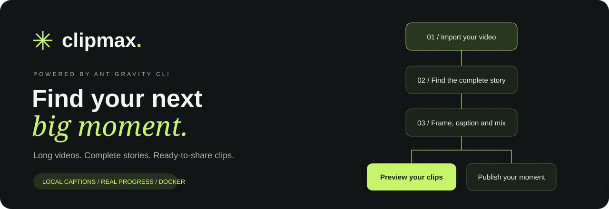
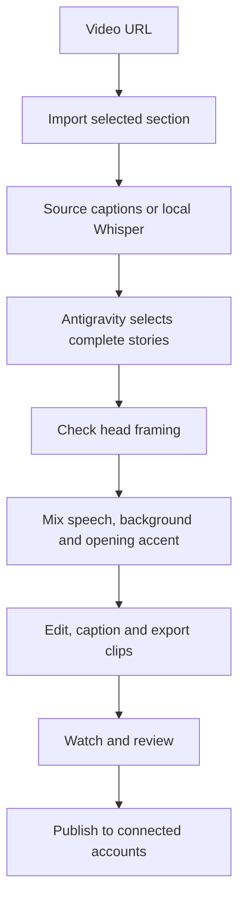

<div align="center">



**Turn a long video into short clips with a story worth finishing.**

[](https://github.com/xASHx26/clipmax---Cliping-with-antigravity-cli/actions/workflows/ci.yml)


[Run with Docker](#run-with-docker) · [Desktop development](#desktop-development) · [Plugins](#plugins-live-inside-clipmax) · [Publishing](#preview-then-publish)

</div>

## Your content, reimagined

Paste a video link. Find the weird reaction, unexpected reveal, emotional story, or standout exchange. Clipmax imports the selected section, creates timed captions, asks Antigravity to select complete moments, and exports clips you can watch before sharing.

| In the studio | What it does |
| :--- | :--- |
| **Link → clips** | Import recorded YouTube, Twitch, Vimeo, TikTok, Facebook, and Instagram videos. Scan up to two hours of a longer recording. |
| **Story-aware selection** | Look for setup, context, and payoff. Uncertain endings are flagged for review. |
| **Local AI captions** | Use source subtitles or transcribe audio with the bundled multilingual Whisper model. Export animated phrase captions with word highlights, or choose steady/clean styles; SRT downloads remain available. |
| **Head-safe layouts** | Sample faces and camera panels, add headroom, or preserve the full source over a blurred background when uncertain. |
| **Mood-aware audio** | Keep speech clear, duck background beds, and choose varied opening accents to suit the edit. Choose 17 opening accents and 13 background styles with per-clip arrangements, or upload your own audio. |
| **Live project tree** | Follow the vertical workflow with animated connections and progress from actual media-tool telemetry. |
| **Review and refine** | Play previews, trim, edit captions and titles, adjust mood, recheck framing, and delete or restore projects. |
| **App-side MCP** | Connect optional editing and research services in the Plugins tab and run tools with reviewed inputs. |
| **Multi-platform publishing** | Assisted browser posting in the desktop app, or direct API uploads with supported account permissions. |



Editorial scores and mood labels are suggestions. Framing checks sample six frames per clip; they are not continuous tracking. Review captions, composition, and story endings before posting. No tool can guarantee views.

## Run with Docker

Requires **Docker Engine or Docker Desktop with Linux containers**, and **Docker Compose v2**. The container serves the studio in your browser; it does not run the Windows Electron shell.

```bash
git clone https://github.com/xASHx26/clipmax---Cliping-with-antigravity-cli.git
cd clipmax---Cliping-with-antigravity-cli
docker compose up -d --build
```

Open **[localhost:4310](http://localhost:4310)**. No `.env` file is needed to start the studio. The first build downloads dependencies, the speech model, the face model, and the official Antigravity CLI. Allow several minutes and enough disk space for video imports.

### Connect your AI

The image includes `agy`. A container is a separate Linux environment: your Windows Antigravity sign-in is **not** automatically shared with it.

```bash
docker compose exec -e SSH_CONNECTION="container" clipmax agy
```

Complete the CLI setup. The SSH environment requests Antigravity's documented remote sign-in flow: open the printed URL in your browser and return its authorization code to the terminal. Exit the CLI when finished. The home volume retains CLI settings and any credential files the CLI saves. Google's native keyring integration can require a Linux Secret Service; a personal-account login inside a headless container has not been verified. See [Google's authentication guide](https://antigravity.google/docs/install/) for supported headless and enterprise authentication.

For a browser-based alternative, open **AI settings** and supply your own Gemini API key, then choose Gemini as the project engine. Gemini API usage has its own quota and billing. Nothing is embedded in the image. Keep **Model** empty for the CLI default, or use an actual model ID listed by your installed CLI.

### Daily commands

```bash
docker compose logs -f --tail 100       # Follow app logs
docker compose stop                    # Stop the studio
docker compose start                   # Start it again
docker compose up -d --build            # Rebuild after pulling updates
docker compose run --rm -T clipmax npm test
docker compose run --rm -T clipmax node scripts/verify-container.mjs
```

The container includes Node.js 22, FFmpeg with subtitle support, yt-dlp, CPU Whisper, the face model, and Antigravity. whisper.cpp and yt-dlp versions are selected in the Dockerfile; the official Antigravity installer follows Google's rolling channel and verifies its downloaded payload with SHA-512.

### Storage and connections

| Docker volume | Contents |
| :--- | :--- |
| `clipmax_projects` | Downloaded sections, transcripts, exports, project progress, trash, encrypted app connections, and the app vault key. |
| `clipmax_antigravity-home` | The container user's Antigravity settings, caches, and CLI-managed authentication files. |

The app generates its vault key on first start with restricted file permissions. Restarting preserves it. Back up the **entire projects volume**, including settings and `vault.key`; encrypted connections need the same key to reopen. The key and encrypted data share a local volume, so disk and backup access controls still matter. Advanced deployments can supply `CLIPMAX_VAULT_KEY_FILE` as a read-only Docker secret containing a 32-byte base64 key.

`docker compose down` keeps named volumes. **Adding `--volumes` removes their data.** Interrupted processing is marked stopped on restart and can be retried; uncertain uploads require checking the platform before retrying.

The published port is bound to `127.0.0.1`, and Host/Origin checks remain enabled. This is a local, single-user application. Public hosting needs authentication and additional deployment work; do not expose port 4310 directly to the internet.

## Animated captions and fresh audio

Choose **Pop & highlight**, **Word highlight**, or **Clean phrases** under editing settings. Captions use short phrases, bold outlines, safe positioning, and font fitting. Whisper full JSON preserves word/subword timestamps when valid; source-caption tracks and older projects use estimated word timing. SRT downloads stay plain and portable. To update an existing unposted clip, open Edit clip and choose **Re-render captions & sound**.

Automatic batches vary suitable music families and save an arrangement seed for each clip, so exporting again preserves the chosen mix. **New background variation** chooses another arrangement without changing the original voice. New original sounds include tight bass drops, rimshots, rewinds, camera snaps, sparkle reveals, error bloops, cartoon slides, energy hits, and bright glass accents. Backgrounds add lo-fi keys/drums, bouncy bass, comedy pizzicato, cinematic piano/pads, and suspense pulses alongside fingerpicked acoustic, playful fiddle/plucks, epic orchestral builds, and the existing options. These are original synthesized arrangements, not extracted meme soundtracks.

Reference videos supplied for this update: [Jack reaction edit](https://www.youtube.com/shorts/8PwGWe7cZbU), [golf commentary](https://www.youtube.com/shorts/C3rTyacPgM8), [alarm demonstration](https://www.youtube.com/shorts/nCjoqIu_N1U), and [Gatorade edit](https://www.youtube.com/shorts/u4kTT35aoIY). Frame inspection shows short commentary captions versus persistent meme headlines. Antigravity also analyzed the audio through its native media reader: reaction vocals/pitch drops, acoustic/folk backing, fiddle/chime cues, and an orchestral swell with bass/energy accents were reported. Exact soundtrack identities are unconfirmed; reference audio is not shipped with Clipmax. See the [reference study](docs/reference-study.md).

## Preview, then publish

Use **Watch clip** in Clip studio or Project tree to see the final video with its audio and captions. Manual review is the default.

**Auto-upload after export** is optional for new projects. It requires consent and verified API accounts for every selected destination. A changed account, unconfirmed story ending, or uncertain interrupted upload blocks automatic posting.

| Connection | Desktop app | Docker / browser studio |
| :--- | :--- | :--- |
| **Continue in your browser** | Opens the platform upload page, copies the caption, and reveals the export. You select the account, attach the video, and finish posting. | The desktop handoff is unavailable. Download the clip and post in your own browser. |
| **Direct API** | Supported with valid permissions and tokens. | Uses the same backend upload integrations and account settings. |
| **Account verification** | API tokens are verified; browser connection labels are not verified identities. | Same API verification rules. |

Official publishing APIs still impose platform requirements: YouTube/TikTok OAuth need registered applications; TikTok can require posting approval; Facebook publishes to Pages; Instagram needs a professional account and publicly accessible HTTPS media. Browser sign-in does not grant API publishing permissions. Real-account uploads have not been verified across every platform.

Account rotation and automatic Antigravity quota failover are **not implemented**. Clipmax uses the CLI account you explicitly sign into.

## Plugins live inside Clipmax

Open **Plugins** in the app sidebar. Built-in audio, story, and framing tools work locally. Optional **Descript** and **vidIQ** MCP presets connect through the official MCP SDK using Streamable HTTP and supported OAuth flows.

After connecting a service, inspect its live tool list, review the generated input form, and approve a tool run. These are app-side connections, independent of plugins in an AI chat. Service permissions, subscriptions, credits, and available tools apply. MCP tools are exposed for explicit runs; they do not automatically replace the whole clipping pipeline. Remote services cannot fetch `localhost` media. Authenticated third-party tool runs require verification with your own account.

## Desktop development

The desktop shell targets **Windows x64**. Install **Node.js 22+** and sign into the official [Antigravity CLI](https://antigravity.google/docs/getting-started?tab=cli).

```powershell
npm ci
npm run setup
npm run desktop
```

Setup downloads yt-dlp, the Windows Whisper runtime and model, and the local face model. FFmpeg comes from `ffmpeg-static`. Building Electron needs substantially more disk space than this source repository.

```powershell
npm test
node scripts/verify.mjs
npm run build:app
```

The portable executable is generated in `release/` and is unsigned. It bundles media tools and models; Antigravity still needs its own installation and sign-in. Desktop projects live in the Windows application-data directory under `clipmax-studio`. Use **Clipmax → Open projects folder** to find them.

`npm start` runs the local browser studio. Outside Docker, browser connections are memory-only unless you provide `CLIPMAX_VAULT_KEY`; Electron manages persistent key storage automatically. `.env.example` documents optional development settings. Linux users should use Docker for the bundled speech runtime.

## Under the hood

```text
desktop/             Electron shell and browser publishing handoff
public/              Studio UI, previews and animated project tree
lib/                 AI, captions, framing, audio, MCP and publishing
server.mjs           Local HTTP API and processing queue
docker/              Container startup and persistent vault key
scripts/             Setup and media verification tools
test/                Unit and integration tests
Dockerfile           Multi-stage Linux image
compose.yaml         Local service and persistent volumes
.github/workflows/   Container build, tests and media smoke check
```

CI builds the actual Linux image, runs the test suite inside it, transcribes a sample, loads the face model, renders a captioned video with sound, and checks the running HTTP service and cross-origin restrictions. CI does not sign into personal AI/social accounts or publish posts.

Downloaded videos, `.env` files, credentials, local project data, dependencies, and packaged executables are excluded from Git and the Docker build context. AI analysis sends transcript excerpts to the chosen provider; optional direct Gemini video analysis uploads an analysis proxy. Local captions and face detection run on the CPU.

## Credits and third-party software

Built with [Antigravity](https://antigravity.google/docs/), [Electron](https://www.electronjs.org/), [FFmpeg](https://ffmpeg.org/), [yt-dlp](https://github.com/yt-dlp/yt-dlp), [whisper.cpp](https://github.com/ggml-org/whisper.cpp), [Whisper](https://github.com/openai/whisper), [TensorFlow.js](https://github.com/tensorflow/tfjs-models/tree/master/face-detection), and the [MCP SDK](https://github.com/modelcontextprotocol/typescript-sdk).

Third-party components and models retain their own licenses; applicable model/runtime license files are included in the image. No reference creator footage, borrowed soundtracks, social accounts, or credentials are distributed. Use source media and custom sounds you have permission to use.

---

<div align="center">
<b>One source. More possibilities.</b><br/>
Made for your next big moment.
</div>
